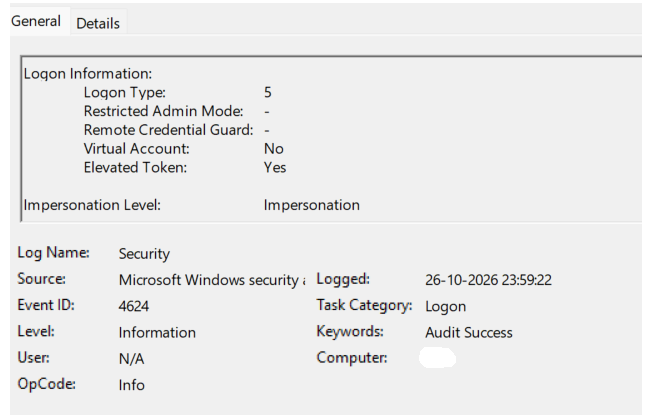
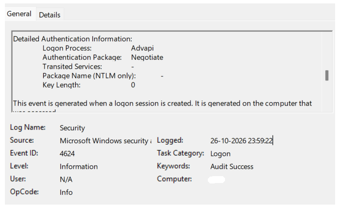

# Project 01 — Windows Event Log Investigation

**Status:** Completed — Windows service logon investigation documented

**Type:** Defensive Windows log investigation

## Objective

Examine a Windows Security event, identify the relevant authentication fields, and document what the evidence supports without treating normal system activity as suspicious.

## Environment and Scope

- **Environment:** Personal Windows computer
- **Operating system version:** Not recorded
- **Log source:** Windows Event Viewer — Windows Logs → Security
- **Event ID:** 4624
- **Event timestamp:** 26 October 2026, 23:59:22 IST (UTC+05:30)
- **Scope:** Own Windows system
- **Tools:** Windows Event Viewer
- **Configuration changes:** None; read-only event review

## Workflow

1. Opened Windows Event Viewer.
2. Navigated to Windows Logs → Security.
3. Filtered the Security log for Event ID `4624`.
4. Opened an event and reviewed its General tab.
5. Recorded relevant logon and authentication fields.
6. Captured screenshots of the event details.
7. Interpreted the evidence while avoiding unsupported conclusions.

## Event Details

| Field | Observed value |
|---|---|
| Event ID | `4624` |
| Event description | A logon session was created |
| Logon Type | `5` — Service |
| Target account name (New Logon) | `SYSTEM` |
| Process Name | `C:\Windows\System32\services.exe` |
| Logon Process | `Advapi` |
| Authentication Package | `Negotiate` |
| Transited Services | `-` |
| Package Name (NTLM only) | `-` |
| Key Length | `0` |
| Restricted Admin Mode | `-` |
| Remote Credential Guard | `-` |
| Virtual Account | `No` |
| Elevated Token | `Yes` |
| Impersonation Level | `Impersonation` |

## Evidence Screenshots

### Screenshot 1 — Logon Information

**Evidence file:** `event-4624-service-logon-1.png`

This screenshot records the logon type and additional logon-context fields.

### Screenshot 2 — Detailed Authentication Information

**Evidence file:** `event-4624-service-logon-2.png`

This screenshot records the authentication package, logon process, key length, and related authentication details.

## Analyst Interpretation

Event ID `4624` records a successful logon session. Logon Type `5` indicates a service logon.

The target account is recorded as `SYSTEM` under the **New Logon** section. The recorded process name, `C:\Windows\System32\services.exe`, is consistent with Windows service-related activity.

The `Elevated Token` value of `Yes` indicates that the session was assigned an elevated token. This value alone does not indicate malicious activity.

The `Negotiate` authentication package does not, by itself, establish which underlying authentication protocol was ultimately used.

Based on the fields examined, this event is consistent with Windows service activity. However, one event alone is insufficient to confirm that all system activity is normal or to identify the specific service associated with the event.

## Assessment

- **Finding:** A successful service logon was recorded (Event ID 4624, Logon Type 5).
- **Interpretation:** The observed fields are consistent with Windows service-related activity.
- **Disposition:** No suspicious activity was established from this event alone.
- **Confidence:** High confidence in the recorded event fields; limited confidence in the broader security context because only one event was examined.

## Results and Limitations

- **Verified:** Event ID 4624, the event timestamp, Logon Type 5, target account name (`SYSTEM`), process name, logon process, authentication package, and other recorded fields were reviewed in Event Viewer.
- **Not established:** The specific service associated with the event, whether related activity was expected, or the overall security status of the computer.
- **Limitations:** This review covers one event and does not constitute a full Windows security audit.
- **Possible next steps:** Examine related events and correlate logon IDs and timestamps where appropriate. Record any additional findings only after reviewing the corresponding evidence.

## Evidence Checklist

- [x] Event ID and timestamp recorded
- [x] Relevant logon and authentication fields documented
- [x] Interpretation limited to the available evidence
- [x] Both screenshots checked for personal information
- [x] Final README and screenshot preview verified