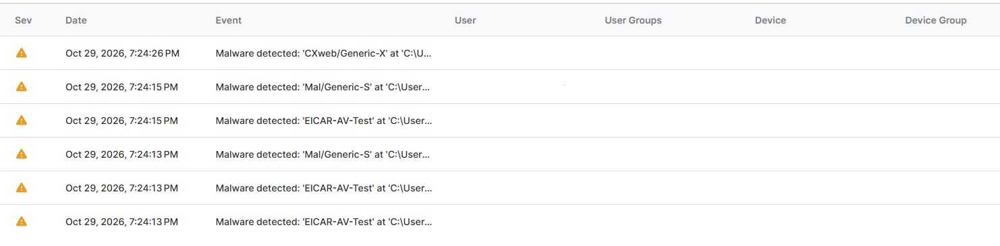
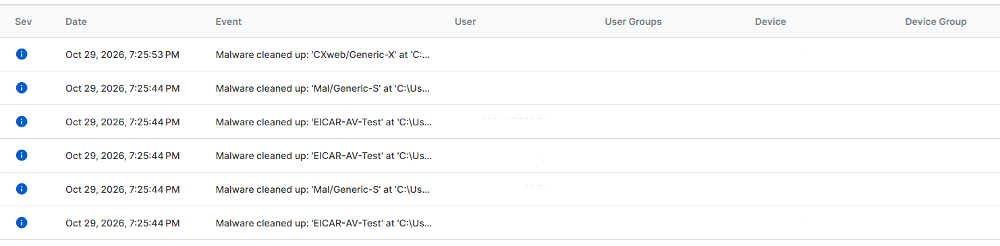

# Project 02 — Endpoint Security Lab

**Status:** Completed — Sophos EICAR detection and cleanup documented

**Type:** Defensive configuration and validation exercise

## Objective

Document how an endpoint-security is scoped, what behaviour it is intended to control, and whether a safe test produces the expected result. Distinguish configuration observations from verified prevention or detection.

## Lab Details

- **Product/console:** Sophos Central — Sophos XDR User Trial
- **Console version:** Not displayed in the console
- **Endpoint:** Personal Windows lab VM
- **Policy/control area:** Threat Protection and EICAR detection
- **Policy scope:** Own Windows lab VM only
- **Test date:** 29 October 2026
- **Configuration changes:** No policy changes made during the documented test

## Test Record

| Item | Record |
|---|---|
| Objective | Verify whether Sophos detects and cleans up a harmless antivirus test file on the lab endpoint. |
| Preconditions | Windows VM online; XDR agent active; real-time scanning and Live Protection enabled. |
| Safe test action | Ran the EICAR antivirus test on my own Windows VM. |
| Expected result | Sophos detects the test file and reports a protective action. |
| Actual result | Sophos reported "Malware detected" followed by "Malware cleaned up" for the EICAR test file. |
| Evidence | `sophos-malware-detected.png` and `sophos-malware-cleaned-up.png` |
| Outcome | Pass — detection and cleanup were reported for the EICAR test. |

## Baseline Review

The endpoint status and selected Threat Protection settings were inspected in Sophos Central.

| Item | Observed result |
|---|---|
| Endpoint health | Good |
| Connection status | Online |
| Agent mode | XDR |
| Real-time scanning | On |
| Live Protection | On |
| Detect malicious behavior | On |
| Exploit mitigations | On |

These settings were observed in the console. Their presence does not independently prove that every protection feature is effective against every threat.

## Evidence Screenshots — Sophos EICAR Test

### 1. Malware Detected

### 2. Malware Cleaned Up

## Analyst Interpretation

Sophos reported detecting the EICAR test file and subsequently reported "Malware cleaned up." This supports a successful detection and cleanup outcome for the harmless test file on the lab endpoint.

The result does not establish that Sophos will detect every real malware sample, that every endpoint-security control is effective, or that all possible threats are prevented.

The assessment is limited to the observed EICAR test result and the configuration information visible in Sophos Central.

### Additional Detection Entries

The Sophos screenshots also display entries labelled `Mal/Generic-S` and `CXWeb/Generic-X`.

These entries were visible during the review but were not investigated as part of the EICAR validation exercise. Their causes and relationship to the EICAR test were not established.

The EICAR conclusion is based only on the entries identified as EICAR test detections.

## Result and Limitations

- **Verified:** The Windows VM showed Good health, Online connection status, and XDR agent mode. The selected Threat Protection settings were displayed as On. Sophos reported detection followed by cleanup of the EICAR test file.
- **Not verified:** Detection or prevention effectiveness against real malware, effectiveness of every Sophos control, or the behaviour of other endpoints.
- **Limitations:** The exercise covered one personal Windows VM and one harmless antivirus test file. It was not a comprehensive security assessment.

## Publication Checklist

- [x] Baseline endpoint status documented
- [x] Policy/control area and lab scope identified
- [x] Expected behaviour and actual result recorded
- [x] Conclusions limited to the observed EICAR test
- [x] Both screenshots sanitized and uploaded
- [x] Final document and screenshots verified together