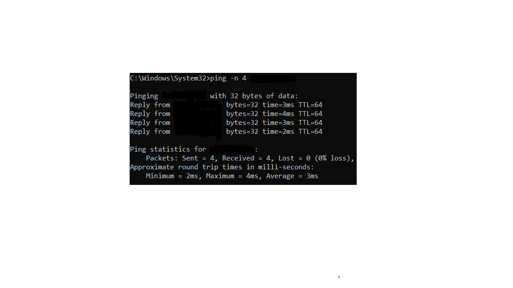
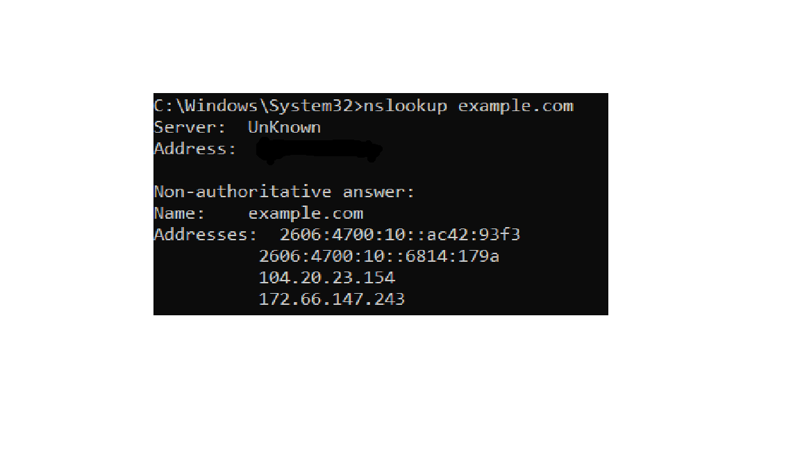
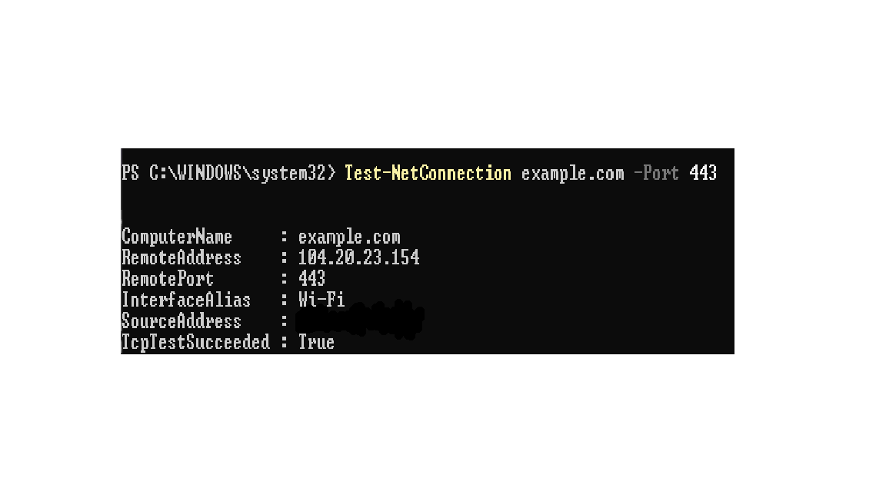

# Project 03 — Basic Network Triage

**Status:** Completed — initial connectivity checks documented with three screenshots

**Type:** Foundational defensive cybersecurity lab

## Objective

Perform basic, read-only network checks on a Windows laptop and interpret the results to assess local gateway reachability, DNS resolution, and TCP connectivity.

## Investigation Question

Can my Windows laptop reach its default gateway, resolve a domain name, and establish a TCP connection to a website on port 443?

## Lab Details

- **Environment:** Physical Windows laptop
- **Operating system:** Windows; version not recorded
- **Scope:** Own computer and connectivity checks to `example.com`
- **Test date:** 28 October 2026
- **Tools:** Command Prompt and PowerShell
- **Configuration changes:** None

Private IP addresses, the actual gateway address, and DNS server details are omitted.

## Test Record

| Item | Record |
|---|---|
| Objective | Check local network configuration, gateway reachability, DNS resolution, and TCP connectivity. |
| Preconditions | Access to my own Windows laptop and its built-in diagnostic tools. |
| Safe test action | Ran `ipconfig`, a gateway ping, `nslookup`, and `Test-NetConnection`. |
| Expected result | Network configuration is present, the gateway responds, DNS returns a result, and the TCP connection succeeds. |
| Actual result | An IPv4 address and gateway were present; ping succeeded; DNS returned IP addresses; `TcpTestSucceeded` was `True`. |
| Evidence | Gateway ping, DNS lookup, and TCP connectivity screenshots embedded in the README. |
| Outcome | Initial connectivity checks succeeded within the scope tested. |

## Commands and Observations

| Test | Command | Observed Result | Interpretation |
|---|---|---|---|
| Network configuration | `ipconfig` | IPv4 address and default gateway present | Network configuration was available. |
| Gateway connectivity | `ping -n 4 [default gateway]` | Successful replies received | The laptop could reach its default gateway during the test. |
| DNS resolution | `nslookup example.com` | IP address records returned by DNS lookup | DNS resolution for `example.com` succeeded during the test. |
| TCP connectivity | `Test-NetConnection example.com -Port 443` | `TcpTestSucceeded : True` | A TCP connection to the destination on port 443 succeeded. |

**Command note:** `[default gateway]` is a placeholder for the actual gateway address used during testing. It is not typed literally.

### Evidence Screenshot — Gateway Ping

### Evidence Screenshot — DNS Lookup

### Evidence Screenshot — TCP Connectivity

## Analyst Interpretation

The observed results support that the laptop had an IPv4 configuration and a default gateway, could reach that gateway, could resolve `example.com`, and could establish a TCP connection to the destination on port 443.

No connectivity failure was reproduced during these checks.

These results do not prove that every internet service is available or that the network is secure. A successful TCP connection to port 443 does not, by itself, verify the complete HTTPS session, TLS certificate validation, or successful loading of a web page.

## Result and Limitations

- **Verified:** An IPv4 address and default gateway were present; the gateway ping succeeded; DNS resolution returned a result; and TCP connectivity to port 443 succeeded.
- **Not verified:** Connectivity to all destinations, intermittent network problems, full HTTPS behaviour, TLS certificate validation, or the effectiveness of firewall and endpoint-security controls.
- **Limitations:** Only one computer and one domain were tested. Exact IP addresses and DNS server details were omitted from the report. Ping packet statistics are available in the screenshot evidence. The routing table was not reviewed using `route print`.
- Review the screenshots periodically and investigate further if a specific connectivity problem occurs.

## Publication Checklist

- [x] Investigation question and environment documented
- [x] Commands and observed results recorded
- [x] Private network details omitted from the written report
- [x] Conclusions limited to the evidence collected
- [x] Three sanitized screenshots added and displayed in GitHub