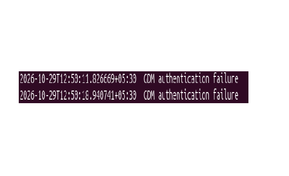

# Project 04 — Linux Authentication Log Review

**Status:** Completed — read-only investigation and evidence documented

**Type:** Defensive learning lab

## Objective

Review authentication-related logs on a Linux lab system, identify recorded authentication and session events, and assess what the available evidence shows without assuming that failed authentication proves malicious activity.

## Environment and Scope

- **Distribution/version:** Ubuntu 26.04.1 LTS
- **Log source:** `/var/log/auth.log`
- **Review period:** 29 October 2026, approximately 12:50–13:02 IST (UTC+05:30), based on the authentication-failure timestamps and the session activity reviewed. Some commands displayed recent log entries outside this period.
- **Authorized scope:** Own Ubuntu virtual machine
- **Tools:** Terminal, `grep`, `sed`, `tail`, and `last`
- **Configuration changes:** None; read-only investigation

Private usernames, hostnames, and other identifying system details are omitted.

## Workflow

1. Checked that `/var/log/auth.log` exists.
2. Recorded the system date, time, and timezone.
3. Searched authentication logs for graphical login authentication failures.
4. Excluded command-audit entries containing `COMMAND=` from the failure search, then reviewed the original matching log entries and confirmed that two matching events remained.
5. Reviewed session-opened and session-closed records.
6. Used `last` to inspect recent login-session history.
7. Compared timestamps and documented observations supported by the available evidence.

## Commands Used

### 1. Verify the Authentication Log

```bash
ls -l /var/log/auth.log
```

**Purpose:** Check whether the authentication log file exists.

**Observed result:** File details were displayed, confirming that the file exists.

### 2. Record the System Timezone

```bash
date '+%Y-%m-%d %H:%M:%S %Z (%z)'
```

**Observed result:** The system reported Indian Standard Time (IST), UTC+05:30.

### 3. Search for GDM Authentication Failures

```bash
sudo grep -F 'pam_unix(gdm-password:auth): authentication failure' /var/log/auth.log | grep -v 'COMMAND=' | sed -E 's/^([0-9]{4}-[0-9]{2}-[0-9]{2}T[0-9:.+-]+).*/\1  GDM authentication failure/' | tail -n 10
```

**Purpose:** Find GDM authentication-failure records, exclude command-audit entries containing `COMMAND=`, and display timestamps with a short event label.

**Observed result:** Two matching events remained after filtering.

### 4. Review Session Events

```bash
sudo grep -E 'pam_unix\([^)]*:session\): session (opened|closed) for user' /var/log/auth.log | tail -n 10
```

**Purpose:** Review authentication-related session-opened and session-closed records.

**Observed result:** The displayed records included graphical login sessions, systemd user sessions, a privileged polkit-1 session, and sudo session-opened and session-closed events. The command displayed the last 10 matching records from the log, which may include events outside the original review window.

### 5. Review Login History

```bash
last -F -n 10
```

**Purpose:** Review recent login-session history and compare recorded times with authentication-log events.

**Observed result:** Local login-session records were displayed, including a session from approximately 12:50 to 12:53 IST and another session beginning around 12:56 IST.

## Findings

| Timestamp (IST, UTC+05:30) | Source/service | Sanitized observation | Interpretation |
|---|---|---|---|
| 29 Oct 2026, 12:50:11 | `gdm-password` | Authentication failure | A failed graphical authentication event was recorded. |
| 29 Oct 2026, 12:50:18 | `gdm-password` | Authentication failure | A second failed graphical authentication event was recorded seven seconds later. |
| 29 Oct 2026, 12:50:28–12:53:15 | Login history / session logs | A local graphical session opened and later closed | The session activity occurred shortly after the two authentication failures. The timing does not establish their cause. |
| 29 Oct 2026, 12:56:07 | `gdm-password` | Session opened | A graphical login session was recorded as opened. |
| 29 Oct 2026, 12:56:07 | `systemd-user` | Session opened | A systemd user session was recorded as opened. |
| 29 Oct 2026, 12:56:17–12:56:28 | GDM greeter / systemd user session | Session closures recorded | The login-screen environment recorded session closures consistent with a login transition. |

## Sanitized Evidence Excerpt

The filtered authentication-log search returned two matching GDM authentication-failure records after command-audit entries containing `COMMAND=` were excluded.

```text
2026-10-29T12:50:11.826669+05:30  GDM authentication failure
2026-10-29T12:50:18.940741+05:30  GDM authentication failure
```

The timestamps are preserved, while usernames, hostnames, and other identifying details are omitted.

### Evidence Screenshot — GDM Authentication Failures



**Evidence file:** `gdm-auth-failures.png`

## Analyst Summary

- **Question:** What authentication and session activity was recorded by the Ubuntu lab system during the review period?
- **Observed facts:** Two GDM authentication-failure records were identified at 12:50:11 and 12:50:18 IST. Session-opened and session-closed records, along with login-history entries, were also reviewed.
- **Assessment:** **Inconclusive.** The failures could be consistent with incorrect password entry during normal graphical login. The available evidence does not establish an attack or identify who caused the failures.
- **Confidence and limitations:** Confidence is high that the two matching authentication-failure records appeared in the inspected log. Their cause remains unconfirmed. The investigation covered selected log records within a limited time window, not all system activity.
- **Next step:** If further investigation is required, correlate the failure timestamps with relevant session records and other available authentication evidence.

## Result and Limitations

- **Verified:** Two matching GDM authentication-failure records were found in the inspected log. Session-opened and session-closed records and recent login-history entries were also reviewed.
- **Not verified:** Malicious intent, an attacker's identity, remote access, the precise cause of the failures, or a confirmed relationship between the failures and later session activity.
- **Limitations:** This was a read-only review of selected records from one authentication log and recent login history. It was not a complete security audit. The session records provide context but do not independently establish why the authentication failures occurred.

## Evidence Checklist

- [x] Read-only investigation performed on my own lab VM
- [x] Commands and observations documented
- [x] No credentials or private usernames included in the report
- [x] Conclusions limited to the available evidence
- [x] Sanitized authentication-failure screenshot included
- [x] Final document reviewed